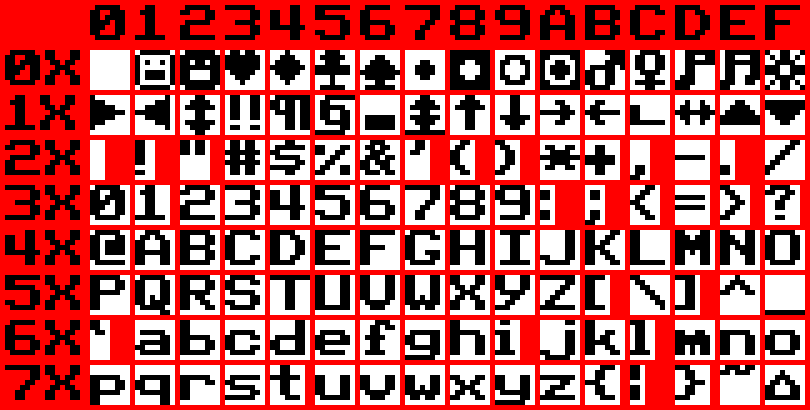

# Glyph tool

A small tool I made to view all the characters in the default font of the graphx library for the TI 84 Plus CE, to help with layout and design of CEDev apps.

---

If you just want the results, here's a screenshot from CEmu.

